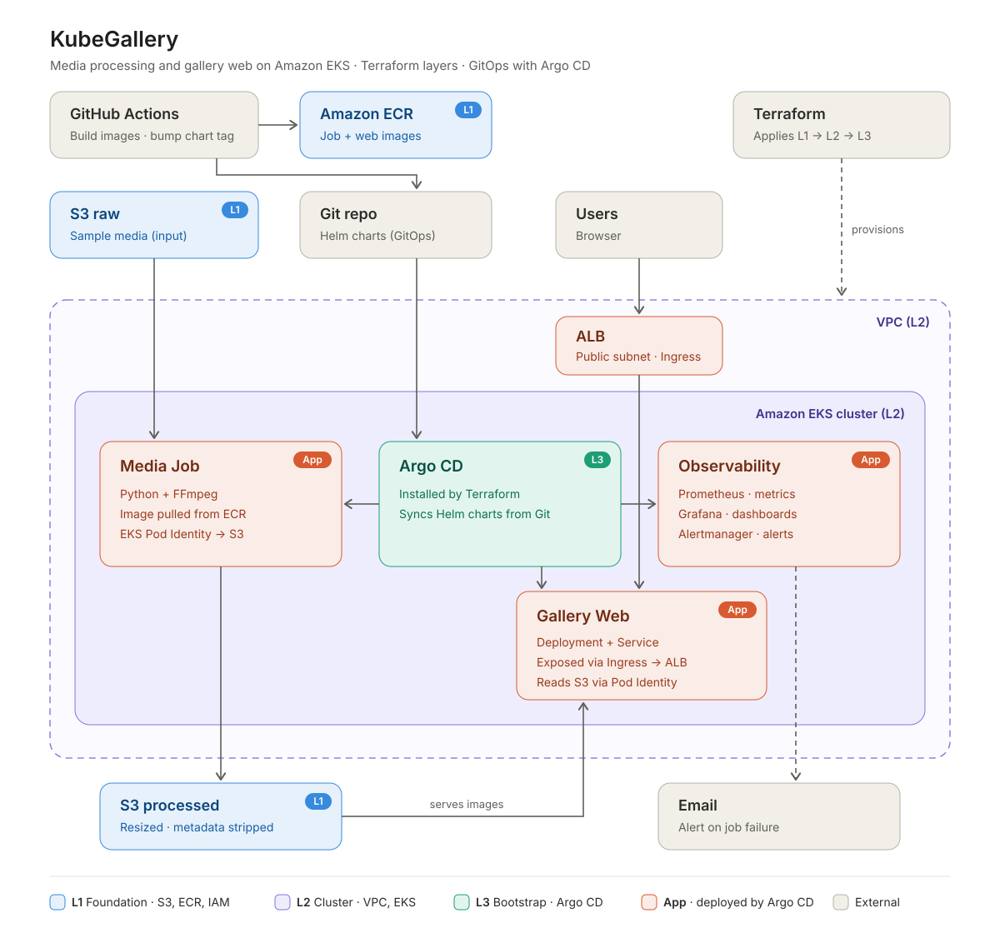

# jh-kubegallery

An experimental EKS project: run a Python + FFmpeg media pipeline as Kubernetes Jobs on Spot capacity, delivered through Argo CD, with all infrastructure in layered Terraform that can be torn down to near-zero cost between sessions.

> **Status:** scaffold only. No AWS resources exist yet.

## Goal

Learn and demonstrate a realistic, cost-aware EKS setup end to end — keyless CI to ECR, workload identity to S3 without static credentials, GitOps delivery, and Spot-backed batch jobs — while keeping the cluster disposable.

## V1 scope

- Upload sample media to **S3 raw**; a **media-job** Kubernetes Job (Python + FFmpeg) resizes it, strips metadata and writes the result to **S3 processed**.
- **Gallery Web** runs as a Deployment + Service and reads images from **S3 processed**. It is exposed through an **Ingress**, which the **AWS Load Balancer Controller** turns into an **ALB** in the public subnets.
- Images are built by **GitHub Actions** and pushed to **ECR** using a **GitHub OIDC** role (no long-lived keys); the workflow then bumps the image tag in the Helm chart.
- **EKS** with a **Spot managed node group**; workloads get S3 access via **EKS Pod Identity**.
- **Argo CD** (installed with the Terraform Helm provider) syncs the Helm charts in this repo.
- **Observability** deployed by Argo CD: Prometheus for job metrics, Grafana dashboards, Alertmanager emailing on job failure.
- Terraform split into three layers with remote state in S3.

## Architecture



| Layer | Path | Contents | Lifetime |
| --- | --- | --- | --- |
| L1 · foundation | [terraform/l1](terraform/l1) | S3 raw, S3 processed, ECR, GitHub OIDC role | Persistent |
| L2 · cluster | [terraform/l2](terraform/l2) | VPC (public + private subnets, NAT), EKS, Spot node group, Pod Identity roles for the media Job, Gallery Web and the AWS Load Balancer Controller | Ephemeral |
| L3 · bootstrap | [terraform/l3](terraform/l3) | Argo CD only | Ephemeral |
| Apps | [charts/](charts) | Deployed by Argo CD from Git: media Job, Gallery Web, AWS Load Balancer Controller, kube-prometheus-stack | Ephemeral |

The ALB is created by the Gallery Web Ingress (through the AWS Load Balancer Controller), not by Terraform.

## Repository layout

```
terraform/l1   foundation layer (placeholder)
terraform/l2   cluster layer (placeholder)
terraform/l3   bootstrap layer (placeholder)
app/           Python + FFmpeg pipeline
charts/        Helm charts
samples/       local test media (contents git-ignored)
docs/          architecture diagram
```

## Milestones

1. **M0 — Scaffold** — repo layout and README placeholders. ✅
2. **M1 — Foundation (L1)** — remote state bootstrap, S3 buckets, ECR, GitHub OIDC role.
3. **M2 — Pipeline image** — Python + FFmpeg app, Dockerfile, GitHub Actions build/push to ECR.
4. **M3 — Cluster (L2)** — VPC, EKS, Spot node group, Pod Identity association for `media-job`.
5. **M4 — Bootstrap (L3)** — Argo CD via Helm provider, Application for `charts/media-job`; GitHub Actions bumps the chart tag.
6. **M5 — End to end** — sample in S3 raw → Job on Spot → resized, metadata-stripped output in S3 processed.
7. **M6 — Observability** — Prometheus, Grafana and Alertmanager via Argo CD; email alert on job failure.
8. **M7 — Gallery Web via Ingress/ALB** — Gallery Web Deployment + Service, AWS Load Balancer Controller, Ingress → ALB in the public subnets, S3 processed read via Pod Identity.
9. **M8 — Teardown drill** — run the teardown plan below and confirm no lingering billable resources.

## Teardown plan

EKS, the NAT gateway, nodes and the ALB are the cost drivers, so they are removed after every session. Run these steps in order:

1. **Delete the Gallery Web Ingress** (or its Argo CD app) and wait until the ALB is gone.
2. **Destroy L3** — `terraform -chdir=terraform/l3 destroy`.
3. **Destroy L2** — `terraform -chdir=terraform/l2 destroy`.
4. **Keep L1** — S3 and ECR cost cents at this scale, and keeping them avoids re-creating the buckets, registry and OIDC role.
5. **Check nothing is left** — no EKS cluster, NAT gateway, load balancer, target group, EBS volume or leftover security group.

Why the Ingress goes first: the ALB is created by the AWS Load Balancer Controller, so Terraform doesn't track it. If the cluster is destroyed while the ALB still exists, nothing is left to delete it: it keeps billing, and its security groups and network interfaces block deleting the VPC.

## License

[MIT](LICENSE)
